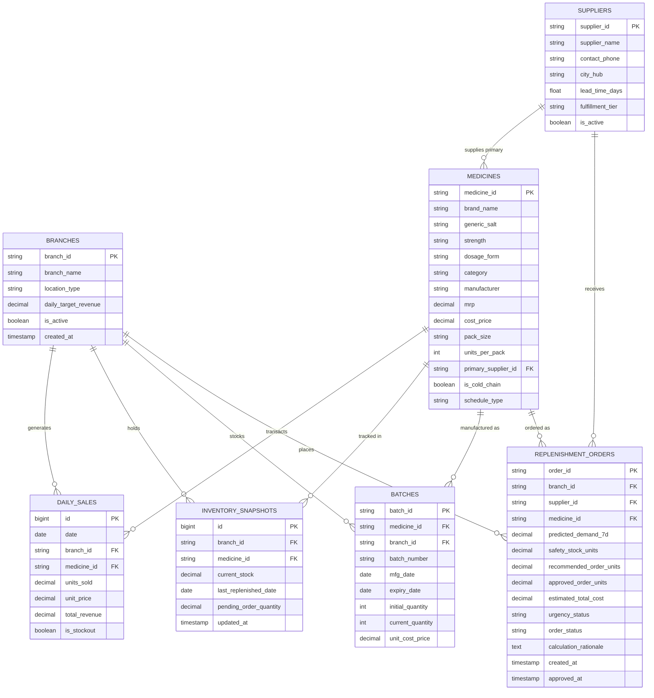

# RemediSync: Database Architecture & Relational Schema Specification

## 1. Relational Model & Entity-Relationship Diagram (ERD)

RemediSync utilizes **PostgreSQL** as its enterprise operational datastore. The schema enforces strict referential integrity across dimensional entities, time-series telemetry, lot-level batches, and operational purchasing orders.



---

## 2. Table DDL Definitions & Constraints

### 2.1 Master Dimensions: `branches` & `suppliers`
```sql
CREATE TABLE branches (
    branch_id VARCHAR(16) PRIMARY KEY,
    branch_name VARCHAR(128) NOT NULL,
    location_type VARCHAR(64) NOT NULL, -- e.g. TRANSIT_HUB, SUBURBAN_RESIDENTIAL
    daily_target_revenue NUMERIC(12, 2) NOT NULL DEFAULT 50000.00,
    is_active BOOLEAN NOT NULL DEFAULT TRUE,
    created_at TIMESTAMP WITH TIME ZONE DEFAULT CURRENT_TIMESTAMP
);

CREATE TABLE suppliers (
    supplier_id VARCHAR(16) PRIMARY KEY,
    supplier_name VARCHAR(128) NOT NULL,
    contact_phone VARCHAR(32) NOT NULL,
    city_hub VARCHAR(64) NOT NULL,      -- e.g. PANBAZAR, PALTANBAZAR
    lead_time_days NUMERIC(4, 2) NOT NULL DEFAULT 1.00,
    fulfillment_tier VARCHAR(32) NOT NULL, -- EXPRESS_PICKUP, SCHEDULED_DELIVERY
    is_active BOOLEAN NOT NULL DEFAULT TRUE,
    created_at TIMESTAMP WITH TIME ZONE DEFAULT CURRENT_TIMESTAMP
);
```

### 2.2 Master Catalog: `medicines`
```sql
CREATE TABLE medicines (
    medicine_id VARCHAR(16) PRIMARY KEY,
    brand_name VARCHAR(128) NOT NULL,
    generic_salt VARCHAR(256) NOT NULL,
    strength VARCHAR(64) NOT NULL,
    dosage_form VARCHAR(64) NOT NULL,    -- TABLET, SYRUP, CAPSULE, INJECTION
    category VARCHAR(64) NOT NULL,       -- Cardiovascular, Antidiabetic, Antibiotic
    manufacturer VARCHAR(128) NOT NULL,
    mrp NUMERIC(10, 2) NOT NULL,
    cost_price NUMERIC(10, 2) NOT NULL,
    pack_size VARCHAR(64) NOT NULL,      -- e.g. "10 Tablets", "100 ml"
    units_per_pack INTEGER NOT NULL DEFAULT 10,
    primary_supplier_id VARCHAR(16) REFERENCES suppliers(supplier_id) ON DELETE RESTRICT,
    is_cold_chain BOOLEAN NOT NULL DEFAULT FALSE,
    schedule_type VARCHAR(16) NOT NULL DEFAULT 'SCHEDULE_H',
    created_at TIMESTAMP WITH TIME ZONE DEFAULT CURRENT_TIMESTAMP
);

CREATE INDEX idx_medicines_category ON medicines(category);
CREATE INDEX idx_medicines_supplier ON medicines(primary_supplier_id);
```

### 2.3 Lot-Level Batch Tracking: `batches`
```sql
CREATE TABLE batches (
    batch_id VARCHAR(32) PRIMARY KEY,
    medicine_id VARCHAR(16) NOT NULL REFERENCES medicines(medicine_id) ON DELETE RESTRICT,
    branch_id VARCHAR(16) NOT NULL REFERENCES branches(branch_id) ON DELETE CASCADE,
    batch_number VARCHAR(64) NOT NULL,
    mfg_date DATE NOT NULL,
    expiry_date DATE NOT NULL,
    initial_quantity INTEGER NOT NULL,
    current_quantity INTEGER NOT NULL CHECK (current_quantity >= 0),
    unit_cost_price NUMERIC(10, 2) NOT NULL,
    created_at TIMESTAMP WITH TIME ZONE DEFAULT CURRENT_TIMESTAMP,
    CONSTRAINT uq_branch_batch UNIQUE (branch_id, medicine_id, batch_number)
);

CREATE INDEX idx_batches_expiry ON batches(expiry_date ASC);
CREATE INDEX idx_batches_branch_med ON batches(branch_id, medicine_id);
```

### 2.4 Transactional Telemetry: `daily_sales`
```sql
CREATE TABLE daily_sales (
    id BIGSERIAL PRIMARY KEY,
    date DATE NOT NULL,
    branch_id VARCHAR(16) NOT NULL REFERENCES branches(branch_id) ON DELETE CASCADE,
    medicine_id VARCHAR(16) NOT NULL REFERENCES medicines(medicine_id) ON DELETE RESTRICT,
    units_sold NUMERIC(10, 2) NOT NULL DEFAULT 0.00,
    unit_price NUMERIC(10, 2) NOT NULL,
    total_revenue NUMERIC(12, 2) NOT NULL,
    is_stockout BOOLEAN NOT NULL DEFAULT FALSE,
    CONSTRAINT uq_daily_sales_series_date UNIQUE (branch_id, medicine_id, date)
);

-- Essential high-speed compound index for time-series queries
CREATE INDEX idx_sales_branch_med_date ON daily_sales(branch_id, medicine_id, date DESC);
CREATE INDEX idx_sales_date ON daily_sales(date DESC);
```

### 2.5 Operational State: `inventory_snapshots`
```sql
CREATE TABLE inventory_snapshots (
    id BIGSERIAL PRIMARY KEY,
    branch_id VARCHAR(16) NOT NULL REFERENCES branches(branch_id) ON DELETE CASCADE,
    medicine_id VARCHAR(16) NOT NULL REFERENCES medicines(medicine_id) ON DELETE RESTRICT,
    current_stock NUMERIC(10, 2) NOT NULL DEFAULT 0.00 CHECK (current_stock >= 0),
    last_replenished_date DATE,
    pending_order_quantity NUMERIC(10, 2) NOT NULL DEFAULT 0.00,
    updated_at TIMESTAMP WITH TIME ZONE DEFAULT CURRENT_TIMESTAMP,
    CONSTRAINT uq_snapshot_branch_med UNIQUE (branch_id, medicine_id)
);

CREATE INDEX idx_snapshots_branch ON inventory_snapshots(branch_id);
```

### 2.6 Decision Engine Orders: `replenishment_orders`
```sql
CREATE TABLE replenishment_orders (
    order_id VARCHAR(32) PRIMARY KEY,
    branch_id VARCHAR(16) NOT NULL REFERENCES branches(branch_id) ON DELETE RESTRICT,
    supplier_id VARCHAR(16) NOT NULL REFERENCES suppliers(supplier_id) ON DELETE RESTRICT,
    medicine_id VARCHAR(16) NOT NULL REFERENCES medicines(medicine_id) ON DELETE RESTRICT,
    predicted_demand_7d NUMERIC(10, 2) NOT NULL,
    safety_stock_units NUMERIC(10, 2) NOT NULL,
    recommended_order_units NUMERIC(10, 2) NOT NULL,
    approved_order_units NUMERIC(10, 2),
    estimated_total_cost NUMERIC(12, 2) NOT NULL,
    urgency_status VARCHAR(16) NOT NULL, -- CRITICAL, WARNING, OPTIMAL
    order_status VARCHAR(16) NOT NULL DEFAULT 'PENDING_APPROVAL', -- PENDING_APPROVAL, APPROVED, DISPATCHED, REJECTED
    calculation_rationale TEXT NOT NULL,
    created_at TIMESTAMP WITH TIME ZONE DEFAULT CURRENT_TIMESTAMP,
    approved_at TIMESTAMP WITH TIME ZONE
);

CREATE INDEX idx_orders_status ON replenishment_orders(order_status, urgency_status);
CREATE INDEX idx_orders_branch ON replenishment_orders(branch_id, created_at DESC);
```

---

## 3. High-Performance Indexing Strategy

1. **Compound Time-Series Indexing (`idx_sales_branch_med_date`):**
   Time-series queries like lag extraction and rolling average calculation filter by `branch_id` and `medicine_id` then range-scan by `date`. A composite B-Tree index guarantees sub-millisecond retrieval.
2. **FEFO Expiry Scan Indexing (`idx_batches_expiry`):**
   Ascending B-Tree index on `expiry_date` allows the counter dispensing and expiry risk algorithms to find the earliest expiring lots in $O(\log N)$ time.
3. **Unique Grid Constraint (`uq_daily_sales_series_date`):**
   Prevents accidental duplicate ingestion of sales records for the same series on the same date.

---

## 4. Connection Pooling & Production Sizing
- **ORM / Driver:** SQLAlchemy 2.0 + asyncpg (or psycopg3) for async connection pooling in FastAPI.
- **Pool Sizing:**
  - `pool_size = 20` persistent connections.
  - `max_overflow = 10` temporary burst connections.
  - `pool_recycle = 1800` (recycle connections after 30 minutes to prevent stale socket drops).
