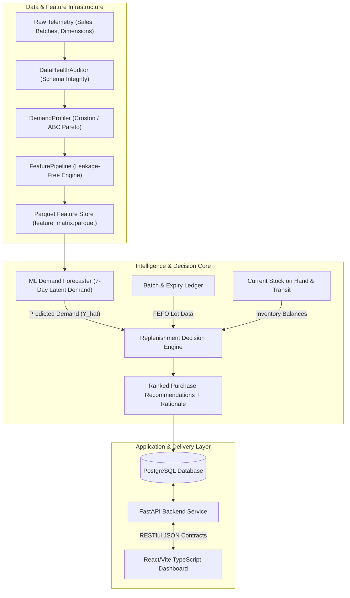
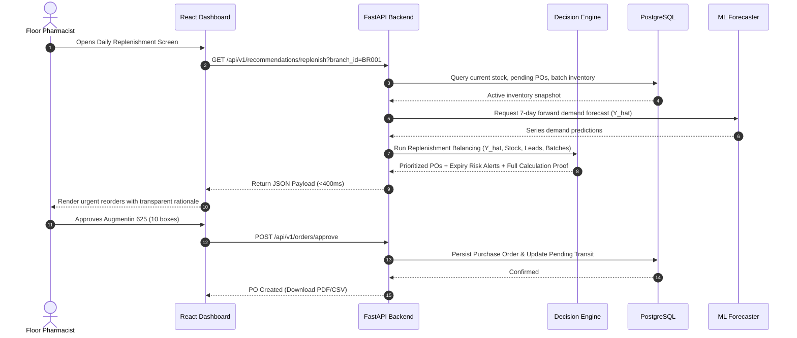

# RemediSync: System Design & Architecture Specification

## 1. Architectural Principles & High-Level Topology

RemediSync is structured as an enterprise modular monorepo. It couples an asynchronous Python/FastAPI analytics backend with a TypeScript/React frontend while preserving clean boundaries between data pipelines, ML inference, and deterministic business rules.



---

## 2. The Core Architectural Boundary (The Golden Rule)

In novice AI systems, models are frequently asked to output commercial purchase orders directly:
$$\text{Model}(X) \longrightarrow \text{Order } 50 \text{ Units}$$
**This is an anti-pattern that violates enterprise safety standards.** 

RemediSync enforces a strict, mathematically isolated separation of concerns:

```
┌────────────────────────────────────────────────────────┐
│             MACHINE LEARNING FORECASTER                │
│  - Task: Statistical estimator of customer demand      │
│  - Input: Historical lags, rolling stats, calendar     │
│  - Output: Predicted 7-day customer demand (Y_hat)     │
└───────────────────────────┬────────────────────────────┘
                            │
                   Predicted Units Sold
                            │
                            ▼
┌────────────────────────────────────────────────────────┐
│             REPLENISHMENT DECISION ENGINE              │
│  - Task: Deterministic operational controller          │
│  - Input: Y_hat, Lead time (L), Stock (S), Transit (P) │
│  - Applies: ROP, Safety Stock (Z-scores), Pack Rounding│
│  - Output: Auditable Purchase Orders + Plain Rationale │
└────────────────────────────────────────────────────────┘
```

### Why This Boundary Is Mandatory:
1. **Explainability & Trust:** A pharmacist will never sign a ₹50,000 distributor invoice if the system says *"A neural net outputted 500 units"*. RemediSync provides human-readable arithmetic: *"Predicted demand is 42 units; safety buffer is 8 units; current stock is 10 units; recommended order: 40 units (4 boxes of 10)"*.
2. **Deterministic Safety Guarantees:** Business constraints (minimum order quantities, distributor lot rounding, budget ceilings, cold-chain capacity) are hard physical constraints that ML loss functions cannot reliably guarantee without hallucinations.
3. **Model Interchangeability:** The forecaster can be upgraded from a Moving Average to HistGradientBoosting, LightGBM, or Deep Learning without altering a single line of replenishment or purchase order logic.

---

## 3. Subsystem Breakdown

### 3.1 Data & Feature Subsystem (`src/features/`)
- **`data_audit.py` (`DataHealthAuditor`):**
  Validates incoming raw feeds for schema conformity, null frequencies, foreign key integrity, and complete time-series grid continuity.
- **`demand_profiler.py` (`DemandProfiler`):**
  Performs Syntetos-Boylan Croston classification ($ADI$ and $CV^2$) to segment series into Smooth, Intermittent, Erratic, and Lumpy quadrants, and generates ABC Pareto revenue classifications.
- **`feature_pipeline.py` (`FeaturePipeline`):**
  Extracts multi-horizon weekly lags (`sales_lag_7`, `lag_14`, `lag_21`, `lag_28`), rolling demand statistics, and calendar encodings under the strict `.shift(1)` temporal rule (zero lookahead leakage). Exports to compressed Parquet format.

### 3.2 Machine Learning & Evaluation Subsystem (`src/models/`)
- **`baseline.py`:** Evaluates heuristic naive benchmarks (7-day Moving Average, Seasonal Naive) to establish performance baselines.
- **`forecaster.py`:** Classical ML ensemble (Ridge Regression, HistGradientBoosting, LightGBM) trained on walk-forward chronological splits.
- **`evaluator.py`:** Computes Weighted Absolute Percentage Error (WAPE), Mean Absolute Error (MAE), Root Mean Squared Error (RMSE), and Aggregate Bias.

### 3.3 Replenishment & Decision Subsystem (`src/decision/`)
- **`inventory_policy.py`:** Implements dynamic safety stock ($SS$) and reorder point ($ROP$) formulations based on supplier lead times and therapeutic criticality.
- **`order_generator.py`:** Aggregates series-level deficiencies into consolidated supplier purchase orders, applying pack size ceilings and budget limits.
- **`expiry_intelligence.py`:** Projects predicted sales velocity against batch lot expiration dates to flag batches with high write-off risk prior to the 90-day return window.

### 3.4 API & Serving Subsystem (`src/api/`)
- Built on **FastAPI** with Pydantic v2 data transfer objects (DTOs).
- Implements dependency injection for database sessions and configuration.
- Provides OpenAPI/Swagger documentation at `/docs`.

### 3.5 Management UI (`frontend/`)
- Built with **React 18**, **TypeScript**, **Vite**, and **Tailwind CSS**.
- High-density data tables with sorting, filtering by ABC tier / urgency, and one-click purchase order approval.

---

## 4. Execution Flow & Lifecycle



---

## 5. Security & Isolation Architecture

1. **Credential Isolation:** No database passwords, JWT secrets, or environment credentials exist in repository code. Managed strictly through `.env` and Docker secrets.
2. **Network Isolation:** In production Docker orchestration, the PostgreSQL instance and FastAPI backend run on an internal bridge network (`remedisync-internal`). Only the Nginx reverse proxy exposes ports 80/443 to the public Internet.
3. **Role-Based Access Control (RBAC):**
   - `ROLE_PHARMACIST`: Can view local branch inventory, review and approve purchase orders.
   - `ROLE_ADMIN` / `ROLE_PROCUREMENT`: Can adjust network-wide service level targets, add new suppliers, and view all 4 branches.
